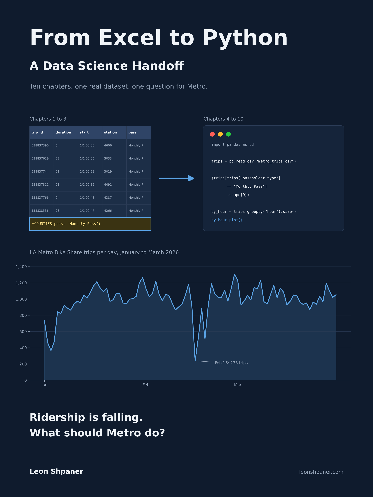

<p align="center">
  <a href="https://lshpaner.github.io/ds_fundamentals/"></a>
</p>

# From Excel to Python: companion materials

A ten-chapter introduction to data science for analysts and managers who have never written code.
Chapters 1-3 run in Excel, chapters 4-10 in Python, all on one real dataset: a quarter of LA Metro Bike Share trips.
The question we carry through every chapter: ridership is falling, what should Metro do?

**Read the book:** https://lshpaner.github.io/ds_fundamentals/

Copyright 2026 Leon Shpaner. All rights reserved. Shared for readers of the book; not for redistribution.

## Layout

```
notebooks/        one folder per chapter: workbook (chapters 1-3) or notebook (chapters 4-10)
exercises/        one folder per chapter: a worked exercise and one to do on your own
docs/             chapter map
core/             dataset registry and loaders
data_gen.py       fetch raw data (typer CLI)
preprocessing.py  cleaning and joins used from chapter 4 on
```

## Data

LA Metro Bike Share publishes anonymized trip data at https://bikeshare.metro.net/about/data/.
`data/` is empty in this repo; `make data_gen` fills it with the quarter's trips and the station table as CSV and Parquet.
